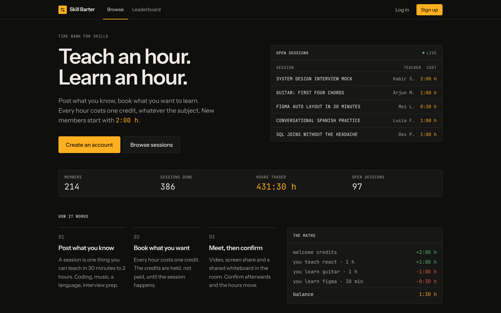
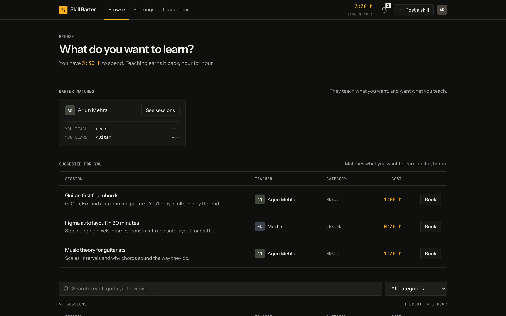
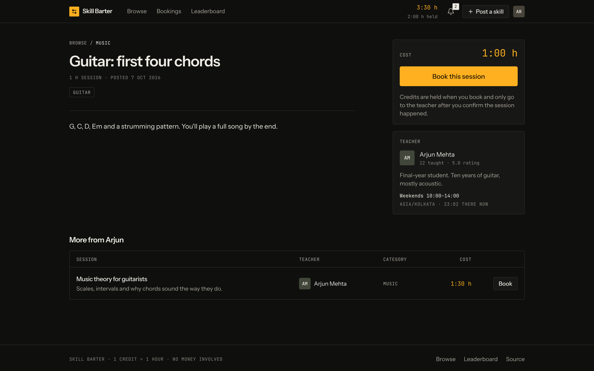
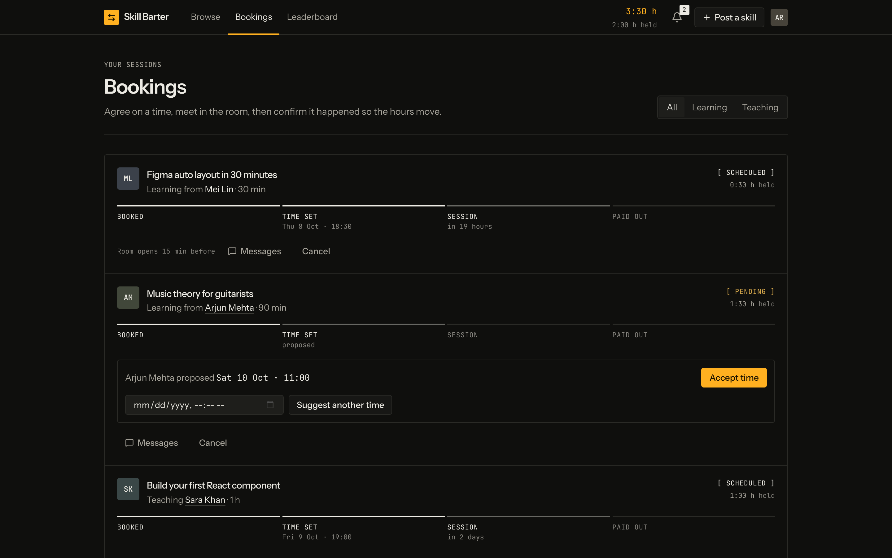
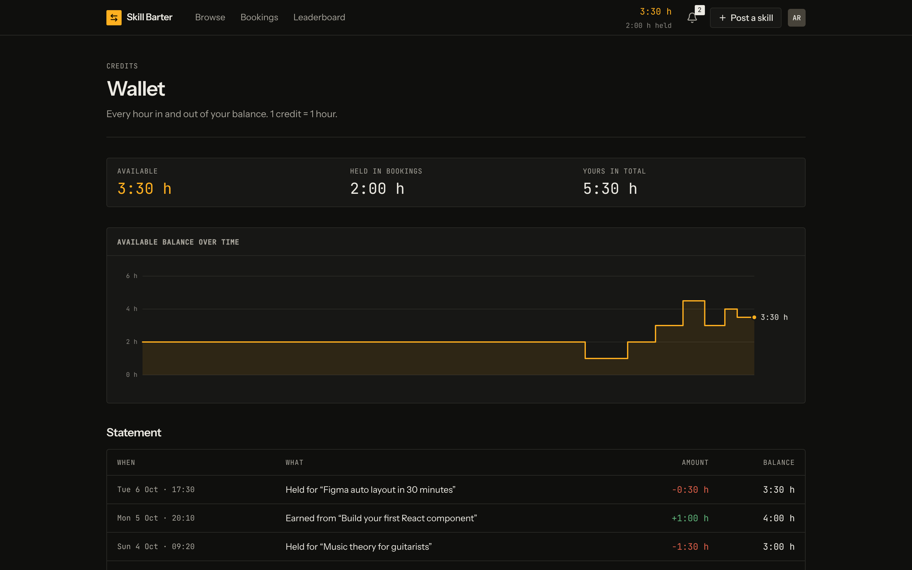
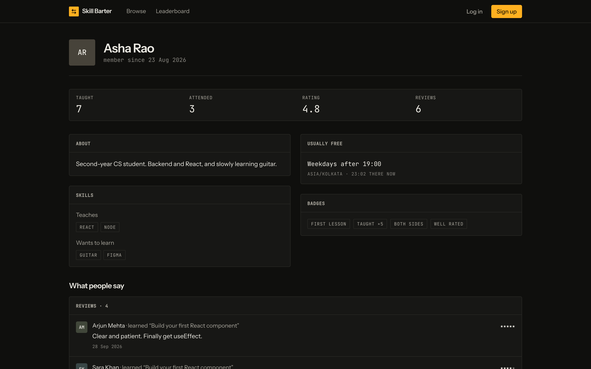
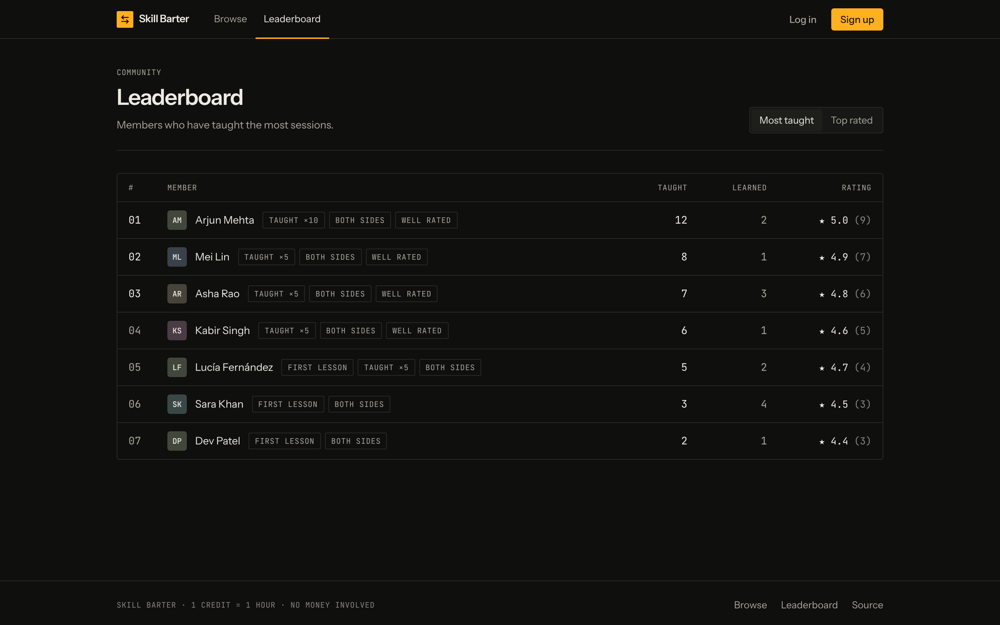
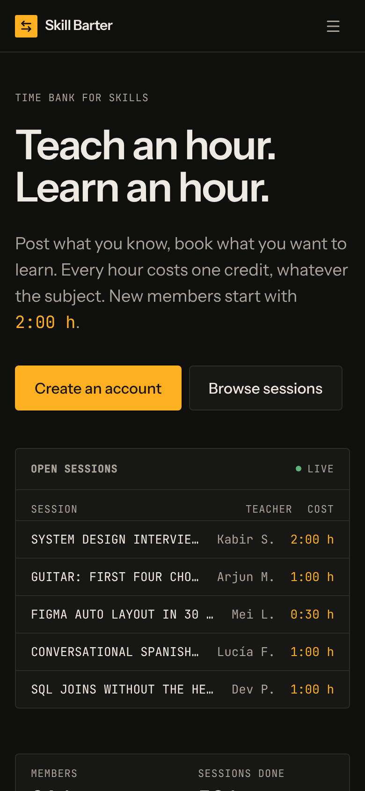

<div align="center">

# Skill Barter

**A decentralized knowledge exchange network powered by time banking.**

Swap your expertise for skills you've always wanted to master. Teach for an hour, gain an hour credit, and invest it into 1-on-1 mentorship with peers across the globe. Zero financial transactions, zero subscriptions—everything happens natively within an interactive virtual workspace featuring real-time video, screen sharing, shared canvas whiteboarding, and persistent chat.

[**Launch Application**](https://skillbarter-web.vercel.app) · [Product Overview](docs/PRODUCT.md) · [PRD Specification](docs/PRD.md) · [Architecture Guide](docs/TECHNICAL.md) · [Deployment Runbook](docs/DEPLOYMENT.md)

[](https://render.com/deploy?repo=https://github.com/Yugpatel-09/BARTER-SKILL)
&nbsp;
[](https://vercel.com/new/clone?repository-url=https%3A%2F%2Fgithub.com%2FYugpatel-09%2FBARTER-SKILL&root-directory=client&env=VITE_SERVER_URL&envDescription=URL%20of%20the%20Skill%20Barter%20API%20on%20Render)




</div>

---

## Executive Summary

Skill Barter transforms learning into an equitable reciprocal economy. Traditional tutoring and modern course platforms gate knowledge behind steep paywalls, while unstructured community forums frequently suffer from one-sided burnout. Skill Barter addresses both problems through an immutable time-banking protocol: **1 hour taught = 1 hour earned**, universally valuing every subject equally whether it is machine learning, conversational Japanese, music production, or system design.

To bootstrap engagement without upfront teaching requirements, every newly registered user is granted an initial reserve of **2 complimentary credits**.

Integrity is enforced at the data layer through a double-entry, append-only financial ledger. Credits are placed into **escrow** when a session reservation is initiated, held securely throughout scheduling and meeting stages, and only **settled** to the mentor once the student validates delivery, via an automated 48-hour dispute timeout, or through manual dispute resolution.

---

## Key Capabilities

| Domain | Architectural Overview & Functionality |
|---|---|
| **Identity & Onboarding** | Direct email/password credentials with instant session tokens, a guided 3-stage profile setup (teaching interests, learning wishlist, weekly schedules), alongside verifiable member dossiers displaying lifetime metrics, badges, and feedback history. |
| **Directory & Discovery** | Flexible session offerings (30, 60, 90, or 120-minute formats at a steady 1 credit/hour standard), indexed by category and customizable tags with instant keyword searching, taxonomic filtering, and pagination. |
| **Smart Barter Engine** | Multi-dimensional matching algorithm highlighting both recommended listings aligned with your learning ambitions, and high-synergy **reciprocal pairings** (peers who provide what you want while seeking what you teach). |
| **Escrow-Backed Booking** | Guaranteed balance reservation at the moment of booking. Bilateral time proposals require mutual agreement before confirmation. Every reservation is paired with an isolated real-time negotiation channel and risk-free pre-session cancellations. |
| **Interactive Studio** | Encrypted peer-to-peer WebRTC video/audio feeds, desktop screen projection, synchronized low-latency collaborative whiteboard canvas, and in-room chat. Accessible only to verified participants within a calibrated window (-15m before start to +3h post-conclusion). |
| **Dispute & Settlement** | Fair payout automation: instant learner confirmation, a 48-hour automated release window in the absence of disputes, or immediate balance freezing whenever an issue report triggers administrative adjudication. |
| **Audit Ledger & Wallet** | Real-time visibility into liquid funds, pending escrow commitments, visual historical balance trajectories, and a transparent cryptographic-style transaction statement. |
| **Reputation System** | Two-way mutual review mechanics (1–5 star grading + structured testimonials), merit achievement badges, and dynamically computed community leaderboards ranked by hours delivered and member satisfaction. |
| **Synchronous Messaging** | Event-driven WebSocket layer powering instant in-app alerts, dynamic balance mutations, and state-machine synchronization without polling. |
| **Focused Aesthetics** | Dark-mode, terminal-inspired visual design language built for high legibility and deep focus. Amber accents are reserved strictly for credit tokens and temporal indicators, satisfying WCAG AA standards. |

---

## Visual Showcase

<table>
  <tr>
    <td width="50%"><br><sub><b>Skill Explorer</b>: Direct barter opportunities & personalized recommendation feed</sub></td>
    <td width="50%"><br><sub><b>Offering Breakdown</b>: Transparent time-cost valuation, mentor profile, and localized time offsets</sub></td>
  </tr>
  <tr>
    <td><br><sub><b>Booking Pipeline</b>: End-to-end lifecycle monitoring from reservation to fund transfer</sub></td>
    <td><br><sub><b>Time Ledger</b>: Real-time available balance, escrow reserves, and ledger transactions</sub></td>
  </tr>
  <tr>
    <td><br><sub><b>Member Dossier</b>: Quantified exchange milestones, endorsements, and earned distinctions</sub></td>
    <td><br><sub><b>Community Standings</b>: Top mentor benchmarks sorted by exchange volume and reviews</sub></td>
  </tr>
</table>

<p align="center"><br><sub>Adaptive responsive layout optimized for mobile viewports</sub></p>

<sub>Visual previews captured using seeded representative test entities.</sub>

---

## Session Pipeline & Lifecycle Flow

```
   [Initiate] ───────► PENDING ──────(Negotiate Time Slots)──────► SCHEDULED ──────► LIVE ROOM ──────► COMPLETED
       │                  │                                            │                                  ▲
       │ Escrow           └─ Reject / Cancel ──► VOIDED                └─ Raise Dispute                   │ Release
       │ Reservation           (Immediate Refund)                             │                           │ Escrow
       └──────────────────────────────────────────────────────────────────────┴──► DISPUTED ──[Admin]────┘ or Refund
```

1. **Reservation & Escrow**: The requested duration's credit cost is deducted from the learner's liquid reserves and moved into escrow status for that booking.
2. **Collaborative Scheduling**: Either party suggests an operational meeting timestamp; validation requires explicit confirmation from the counterparty.
3. **Interactive Session**: The private room environment unlocks 15 minutes prior to the agreed schedule. Media pipelines connect peer-to-peer via direct WebRTC handshakes.
4. **Resolution & Payout**: The learner approves completion to trigger immediate credit release, or the protocol auto-finalizes 48 hours post-session. Unresolved contention locks the funds for administrator intervention.
5. **Mutual Assessment**: Both members submit post-session evaluations, dynamically revising composite trust scores, milestone progress, and leaderboard standings.

Every phase transition executes within an atomic MongoDB ACID transaction, guaranteeing ledger balance consistency and total idempotency against duplicate invocations or race conditions. Comprehensive architectural specifications are available in [TECHNICAL.md › Credits & Bookings](docs/TECHNICAL.md#5-credits-and-booking-lifecycle).

---

## Technology Stack

| Ecosystem Component | Tooling & Rationale |
|---|---|
| **Client Core** | React 19 SPA bundled via Vite 5, styled using Tailwind CSS 3, routed via React Router 7, with Axios HTTP clients |
| **Real-Time Fabric** | Socket.IO 4 establishing bidirectional websockets for notifications, active presence, and whiteboard synchronization |
| **Media Streaming** | Decentralized WebRTC facilitated by PeerJS, paired with an integrated custom PeerServer instance hosted alongside the API |
| **API Server** | Node.js 22 LTS running Express 5, schema validation handled via Zod, scheduled recurring automation powered by node-cron |
| **Persistence Engine** | MongoDB Atlas multi-node Replica Set managed via Mongoose 9, ensuring full multi-document ACID transaction guarantees |
| **Security & Cryptography** | Hardened JSON Web Tokens (JWT) for stateless session authentication, alongside Bcrypt password hashing |
| **Quality Assurance** | Native `node:test` harness, Supertest integration testing, isolated `mongodb-memory-server` replica set environments |
| **Infrastructure** | Vercel (Frontend edge CDN), Render (Full-stack API & WebRTC signaling), MongoDB Atlas (Clustered database tier) |

---

## Local Development Guide

### System Requirements

- **Node.js**: Version **22.x** or higher
- **MongoDB**: Active **Replica Set** cluster instance (a free-tier [MongoDB Atlas](https://www.mongodb.com/atlas) cluster is recommended, as replica sets are mandatory for ACID transactions)

### Quickstart

```bash
# Clone the workspace repository
git clone https://github.com/Yugpatel-09/BARTER-SKILL.git
cd BARTER-SKILL

# 1. Initialize and run the Server (Port: 5000)
cd server
cp .env.example .env        # Configure MONGO_URI and JWT_SECRET
npm install
npm run seed                # Seeds 6 sample profiles, offerings, bookings, and testimonials
npm run dev

# 2. Initialize and run the Client (Port: 5173 - open a separate terminal)
cd client
npm install
npm run dev
```

Pre-seeded testing profiles include `asha@example.com`, `arjun@example.com`, `mei@example.com`, `lucia@example.com`, `kabir@example.com`, and `sara@example.com` (universal password: `password123`).

To test full real-time collaboration and video features locally, authenticate as a teacher in one browser profile and as a learner in a second (or incognito) window.

---

## Development Tooling

| Directory | Command | Description |
|---|---|---|
| `server/` | `npm run dev` | Spins up the backend development server with hot-reload enabled |
| `server/` | `npm test` | Executes the complete integration test suite over an in-memory replica set |
| `server/` | `npm run seed` | Seeds realistic demonstration data through production service layers (`-- --reset` cleans first) |
| `server/` | `npm run make-admin -- user@domain.com` | Elevates an existing user profile to administrative privilege |
| `server/` | `npm run reset` | Purges every database collection clean |
| `client/` | `npm run dev` | Launches the Vite frontend development server |
| `client/` | `npm run build` | Compiles optimized static assets for production deployment |
| `client/` | `npm run lint` | Runs ESLint syntax and code quality verification |
| `client/` | `npm run preview` | Locally serves the production client build output |

*Note: Data destructive scripts (`seed`, `reset`) will automatically refuse execution when `NODE_ENV=production`.*

---

## Configuration & Environment Variables

### Backend Configuration (`server/.env`)

| Variable | Required | Default / Format | Description |
|---|---|---|---|
| `MONGO_URI` | Yes | `mongodb+srv://…/skillbarter` | Connection string to a MongoDB replica set |
| `JWT_SECRET` | Yes | String (min 16 chars) | Symmetric key used to cryptographically sign authentication tokens |
| `CLIENT_URL` | Prod | `https://skillbarter-web.vercel.app` | Explicit CORS origin whitelist applied to API and Socket listeners |
| `NODE_ENV` | No | `development` | Runtime environment target (`development` or `production`) |
| `PORT` | No | `5000` | Port listening configuration |
| `JWT_EXPIRES_IN` | No | `7d` | Token lifetime expiration span |
| `TURN_URL` / `TURN_USERNAME` / `TURN_CREDENTIAL` | No | String | Optional TURN credential payload for restrictive NAT traversal |
| `DNS_SERVERS` | No | `1.1.1.1,8.8.8.8` | Fallback DNS resolvers preventing SRV record lookups failures |

### Frontend Configuration (`client/.env`)

| Variable | Format | Description |
|---|---|---|
| `VITE_SERVER_URL` | `https://skillbarter-ppj7.onrender.com` | Base backend endpoint consumed by REST endpoints, Sockets, and PeerJS |

---

## Repository Anatomy

```
BARTER-SKILL/
├── client/              Vite-powered React Single Page Application
│   └── src/
│       ├── pages/       Route-level view orchestrators
│       ├── components/  UI atomic building blocks, navigation, room studios, and ledger views
│       ├── context/     Global state providers (Authentication, Socket bus, Alert streams)
│       └── lib/         API helpers, utility formatters, and global constants
├── server/              Express REST API, WebRTC PeerServer, & Socket.IO gateway
│   ├── services/        Core domain logic (escrow ledger, booking machines, reputation, matching)
│   ├── routes/          Modular HTTP path endpoints and controller bindings
│   ├── validators/      Zod schema validators enforcing boundary invariants
│   ├── sockets/         Real-time authentication, event routing, and room state
│   ├── jobs/            Scheduled background cron tasks (escrow auto-release)
│   ├── scripts/         Administrative tooling and seed generators
│   └── tests/           Comprehensive automated test suites
├── docs/                Architectural designs, PRDs, UX systems, and deployment specs
└── render.yaml          Infrastructure blueprint for continuous deployment on Render
```

---

## Verification & Testing Standards

Execute server verification:
```bash
cd server && npm test
```

The test runner provisions an isolated in-memory MongoDB replica set, faithfully mirroring production multi-document transactional semantics. After each test case, the harness verifies ledger invariants: total credit conservation, zero negative account states, and complete balance-to-transaction alignment. In addition, race-condition tests validate concurrent booking actions to prevent double-spending or replay vulnerabilities.

Client checks require zero linting errors and a clean production build:
```bash
cd client && npm run lint && npm run build
```

---

## Deployment Architecture

The application is deployed across three specialized cloud tiers:
1. **Frontend**: Hosted on **Vercel** with global edge CDN caching.
2. **API & Realtime Gateway**: Managed on **Render** (blueprint supplied in `render.yaml`).
3. **Database Layer**: Clustered on **MongoDB Atlas** with automated failover and replica set transactions.

Detailed configuration instructions, environment synchronization, and rollback playbooks are cataloged in [docs/DEPLOYMENT.md](docs/DEPLOYMENT.md).

---

## Documentation Index

- **[Product Overview (PRODUCT.md)](docs/PRODUCT.md)**: Core thesis, user dynamics, and economic design.
- **[Requirements Document (PRD.md)](docs/PRD.md)**: User personas, functional requirements, and milestone trajectories.
- **[Technical Architecture (TECHNICAL.md)](docs/TECHNICAL.md)**: Database schemas, state machines, REST contracts, and cryptographic policies.
- **[Design Language (DESIGN.md)](docs/DESIGN.md)**: Token specifications, color palettes, and accessibility standards.
- **[Deployment Manual (DEPLOYMENT.md)](docs/DEPLOYMENT.md)**: Step-by-step setup guides for Atlas, Render, and Vercel.
- **[Contribution Guidelines (CONTRIBUTING.md)](CONTRIBUTING.md)**: Branching models, PR requirements, and coding conventions.
- **[Security Policy (SECURITY.md)](SECURITY.md)**: Vulnerability disclosure and security threat models.

---

## Author & Acknowledgements

Created and engineered by **[Yug Patel](https://github.com/Yugpatel-09)** · [LinkedIn Profile](https://linkedin.com/in/yug-patel-profile)
